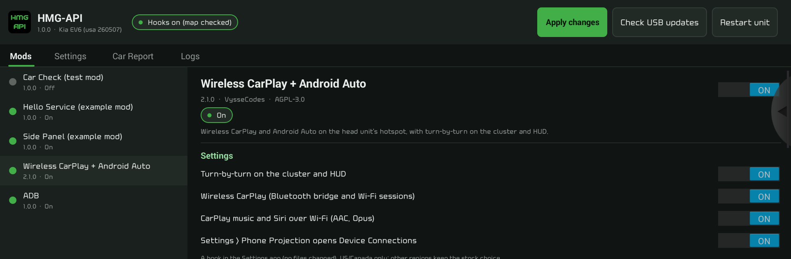

# HMG-API

HMG-API is a mod manager for Hyundai, Kia and Genesis head units with navigation
(Gen5W). Mods add features to the head unit: wireless CarPlay and Android Auto with
turn-by-turn on the cluster and HUD, buttons that do more, pages in the side panel,
and more. You can install as many as you like; they don't overwrite each other, and
removing one puts back exactly what it changed.

## Start here

1. [Supported cars](Supported-cars): check yours first.
2. [Installing HMG-API](Installing-HMG-API): about 10 minutes, parked.
3. [Installing and removing mods](Installing-and-removing-mods)
4. [Using the HMG-API app](Using-the-HMG-API-app)

## Help and requests

- [Troubleshooting](Troubleshooting)
- [Car Report](Car-Report): send what HMG-API needs to support your car.
- [Getting help and asking for things](Getting-help): bugs, new cars and software
  versions, new hook points, ideas.

## More

- [Buttons, the side panel and other things mods add](What-mods-can-add)
- [When two mods want the same thing](When-two-mods-want-the-same-thing)
- [What HMG-API never does](What-HMG-API-never-does)
- [Uninstalling](Uninstalling)
- [Making mods](Making-mods) (for developers)
